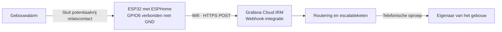

# Gebouwalarm naar Grafana Cloud IRM

Deze ESPHome-configuratie koppelt een fysiek gebouwalarm aan Grafana Cloud **Incident Response & Management (IRM)**. Wanneer het alarm een relaiscontact sluit, verstuurt een ESP32 via wifi een webhook naar Grafana Cloud. IRM handelt de melding af en belt de eigenaar van het gebouw volgens de ingestelde escalatieketen.

De ESP32 detecteert alleen het relaiscontact; de configuratie van ontvangers, telefoonnummers en escalaties gebeurt in Grafana, niet op het apparaat. Home Assistant is hiervoor niet nodig.

## Overzicht



### Wat doet de firmware?

- Gebruikt een **ESP32-C6** met het ESP-IDF-framework. De configuratie is bedoeld voor de **ESPHome Starter Kit van Apollo Automation** (`esp32-c6-devkitc-1`).
- Leest **GPIO6** met een interne pull-up. Een open contact is inactief; een verbinding met **GND** is actief.
- Filtert korte contactwisselingen met een vertraging van **20 ms** bij zowel sluiten als openen.
- Verstuurt bij activering een JSON-bericht naar de ingestelde webhook, met een HTTP-timeout van **10 seconden**.
- Schakelt **GPIO4** (`Accessory Power`) bij het opstarten in voor het Apollo-board. Controleer deze instelling als je een ander board gebruikt.

De melding bevat:

```json
{
  "alert_uid": "relais-<willekeurige hexwaarde>-<willekeurige hexwaarde>",
  "title": "Relaiscontact gesloten",
  "state": "alerting",
  "message": "GPIO6 is verbonden met GND."
}
```

Elke activering krijgt een nieuwe `alert_uid`. Ga dus niet uit van het samenvoegen van opeenvolgende activeringen tot één bestaande melding.

## Bestanden

| Bestand | Doel |
| --- | --- |
| `esphome-alarm.yaml` | Firmwareconfiguratie, GPIO-instellingen en webhookactie. |
| `secrets.yaml.example` | Voorbeeld voor wifi-instellingen, sleutels en webhook-URL. |
| `secrets.yaml` | Lokale geheimen; uitgesloten van Git via `.gitignore`. |

## Benodigdheden

- Het hierboven genoemde ESP32-board, een USB-datakabel en een betrouwbare voeding.
- Een **potentiaalvrij relaiscontact** van het gebouwalarm en bedrading naar de ESP32.
- Een wifi-netwerk met internettoegang naar de Grafana-webhook.
- Toegang tot Grafana Cloud IRM. Je hoeft nog geen account te hebben: je kunt gratis een [Grafana Cloud-account aanmaken](https://grafana.com/auth/sign-up).
- Een computer met Python en ESPHome voor configureren en flashen.

> **Let op:** dit is een aanvullende meldvoorziening, geen vervanging voor een gecertificeerde alarmdoormelding. Voeding, wifi, internet en de Grafana-dienst moeten beschikbaar zijn om te kunnen bellen.

## Aan de slag

### 1. Richt Grafana Cloud IRM in

Heb je nog geen Grafana Cloud-account? [Maak er gratis een aan](https://grafana.com/auth/sign-up) en open daarna IRM.

Gebruik de incoming webhook van Grafana Cloud IRM: de HTTP-aanroep van de ESP32 maakt een alert aan, waarna IRM de ontvanger belt volgens diens notification rules.

1. **Stel het telefoonnummer in.** Laat de eigenaar van het gebouw in diens account via het avatar-menu naar **Profile → IRM settings → Phone verification** gaan en het telefoonnummer toevoegen en verifiëren.
2. **Stel telefonische notificaties in.** Voeg onder **Notification rules** de optie **Phone call** toe aan de standaard notification rules. Gebruik **Make test call** om te controleren of bellen werkt.
3. **Maak een escalatieketen.** Ga naar **IRM → Escalation chains** en maak een keten met een stap die de eigenaar op de hoogte stelt.
4. **Maak de webhook-integratie.** Ga naar **IRM → Integrations → Monitoring systems → Formatted Webhook → New integration**. Maak de integratie aan en kopieer de webhook-URL. Vul deze bij stap 3 hieronder in als `webhook` in `secrets.yaml`.
5. **Koppel de escalatieketen.** Wijs de gemaakte escalatieketen toe aan de **default route** van de integratie.

Een ontvangen webhook leidt alleen tot een telefoontje als ook de routering, escalatieketen en notification rules van de ontvanger correct zijn ingesteld.

### 2. Sluit het relais aan

Gebruik het contact dat **sluit wanneer het gebouwalarm afgaat**:

```text
ESP32 GPIO6 ───── potentiaalvrij relaiscontact ───── ESP32 GND
```

De interne pull-up houdt GPIO6 hoog zolang het contact open is. Sluiten trekt de ingang naar GND en activeert de melding.

**Sluit geen alarmspanning, netspanning of andere externe spanning aan op GPIO6.** Gebruik uitsluitend het geïsoleerde, potentiaalvrije contact. Controleer het aansluitschema van de alarmcentrale en laat de aansluiting bij twijfel door een installateur uitvoeren. Schakel de voeding uit tijdens het aansluiten.

### 3. Installeer ESPHome en vul de geheimen in

Voer vanuit de repository uit:

```bash
python3 -m venv .venv
source .venv/bin/activate
pip install esphome
cp secrets.yaml.example secrets.yaml
```

Heb je al een `secrets.yaml`, sla de laatste stap dan over om je instellingen niet te overschrijven.

Vul in `secrets.yaml` alle waarden in:

| Sleutel | Waarde |
| --- | --- |
| `wifi_ssid` | Naam van het wifi-netwerk. |
| `wifi_password` | Wachtwoord van het wifi-netwerk. |
| `api_key` | Base64-gecodeerde sleutel van 32 bytes voor de versleutelde ESPHome-API. |
| `fallback_password` | Sterk wachtwoord voor het fallback-wifi-accesspoint. |
| `webhook` | Volledige, geheime URL van de IRM-integratie. |

Genereer bijvoorbeeld de API-sleutel met:

```bash
openssl rand -base64 32
```

De API-sleutel beschermt de ESPHome-API; hij is geen authenticatie voor Grafana. De webhook-URL bevat zelf een geheim. Deel die URL niet en commit `secrets.yaml` niet.

### 4. Controleer en flash de firmware

Sluit het board via USB aan en voer uit:

```bash
esphome config esphome-alarm.yaml
esphome run esphome-alarm.yaml
```

ESPHome valideert en compileert de configuratie en laat je een uploadverbinding kiezen. Gebruik voor de eerste installatie de seriële USB-verbinding. De eerste compilatie kan even duren doordat benodigde onderdelen worden gedownload.

Na de eerste installatie zijn updates via het netwerk mogelijk met dezelfde `run`-opdracht. Loguitvoer bekijken kan met:

```bash
esphome logs esphome-alarm.yaml
```

Als verbinden met wifi mislukt, biedt het apparaat een fallback-accesspoint **ESPHome Alarm** met het ingestelde `fallback_password` en een captive portal. De firmware heeft ook een lokale webinterface op het IP-adres van het apparaat.

### 5. Test de volledige keten

Stem de test vooraf af met de ontvanger: dit kan een echte telefonische oproep veroorzaken.

1. Controleer in de ESPHome-logs of het apparaat met wifi verbonden is.
2. Sluit het relaiscontact, of verbind voor een afzonderlijke ingangstest kort GPIO6 met GND.
3. Controleer of de melding **Relaiscontact gesloten** in IRM verschijnt.
4. Controleer of de juiste escalatieketen wordt uitgevoerd en de eigenaar daadwerkelijk wordt gebeld.
5. Open het contact weer en handel de testmelding handmatig af in IRM.
6. Test daarna ook met de echte alarmcentrale, zodat niet alleen de losse ingang maar de volledige keten is gecontroleerd.

## Gedrag en beperkingen

- **Geen herstelmelding:** openen van het contact verstuurt geen `resolved`-bericht. Een melding wordt dus niet automatisch afgesloten wanneer het alarm stopt.
- **Geen periodieke melding:** zolang het contact gesloten blijft, verstuurt de configuratie niet telkens opnieuw een bericht. Een nieuwe activering kan een nieuwe melding opleveren.
- **Geen expliciete retry of wachtrij:** de configuratie bevat geen herhaal- of opslagmechanisme voor een mislukte HTTP-aanroep. Een activering tijdens netwerkuitval kan daardoor verloren gaan.
- **Geen bewaking van de meldketen:** uitval van de ESP32, voeding of verbinding levert vanuit deze configuratie zelf geen storingsmelding op.
- **Herstartgedrag controleren:** test ook een herstart terwijl het contact al gesloten is; vertrouw niet op deduplicatie, omdat elke verzonden melding een willekeurige UID krijgt.
- **Netwerkbeveiliging:** de webinterface heeft in deze configuratie geen authenticatie en OTA heeft geen ingesteld wachtwoord. Plaats het apparaat op een vertrouwd, afgeschermd netwerk en stel deze diensten niet publiek bloot.

## Geplande verbeteringen / TODO

Deze functies zijn nog niet geïmplementeerd:

- [ ] **Alarmstatus herhalen:** stuur periodiek opnieuw de actuele alarmstatus zolang het relaiscontact gesloten is.
- [ ] **Herstelmelding toevoegen:** stuur bij openen van het contact een `resolved`-bericht. Gebruik voor herhaalde meldingen en herstel dezelfde `alert_uid` als voor de oorspronkelijke activering, zodat IRM ze aan hetzelfde alarm kan koppelen.
- [ ] **Retries met back-off en buffering:** bewaar niet-afgeleverde meldingen en probeer opnieuw bij tijdelijke netwerkproblemen of serverfouten, met oplopende wachttijden. Behoud dezelfde `alert_uid` en de volgorde van alarm- en herstelmeldingen.
- [ ] **Testmodus:** stuur testmeldingen naar een aparte IRM-integratie of route zonder telefonische escalatie, zodat de ingang en webhookverwerking gecontroleerd kunnen worden zonder de eigenaar te bellen. Maak duidelijk zichtbaar wanneer de testmodus actief is; deze vervangt niet de volledige test met een echte telefonische oproep.
- [ ] **Heartbeat naar Grafana Cloud:** stuur periodiek een teken van leven, bijvoorbeeld als logregel naar Loki met een vaste apparaatidentificatie. Zo wordt zichtbaar of het apparaat nog kan communiceren.
- [ ] **Waarschuwen bij ontbrekende heartbeat:** configureer een Grafana-alert als binnen een afgesproken tijdvenster geen heartbeat-logregels meer binnenkomen. Routeer deze als waarschuwing, bijvoorbeeld via e-mail of push, **zonder direct te bellen**. Een ontbrekende heartbeat kan ook wijzen op een netwerk- of ingestieprobleem en bewijst niet op zichzelf dat het apparaat uit staat.

## Problemen oplossen

| Probleem | Controleer |
| --- | --- |
| Geen reactie op het relais | Juiste GPIO6/GND-aansluiting, potentiaalvrij contact en of het contact werkelijk sluit. Bekijk de sensorstatus via logs of de lokale webinterface. |
| Geen melding in IRM | Wifi/internet, de webhook-URL in `secrets.yaml` en eventuele HTTP-fouten in de ESPHome-logs. |
| Wel een melding, geen telefoontje | IRM-routering, escalatieketen, rooster en telefooninstellingen van de ontvanger. |
| Meerdere meldingen | Of het relais herhaaldelijk opent/sluit. De filtering is slechts 20 ms en elke activering krijgt een nieuwe UID. |
| Flashen mislukt | USB-datakabel, gekozen seriële poort en eventuele vereiste bootmodus van het board. |

Na wijzigingen in YAML of geheimen moet je de firmware opnieuw bouwen en uploaden. Test wijzigingen altijd tot en met de telefonische oproep.
